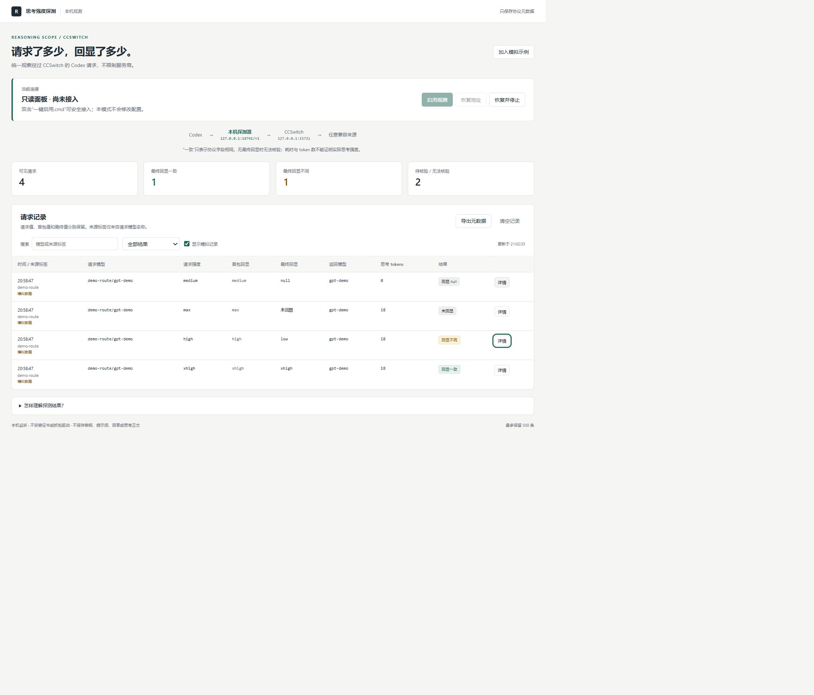
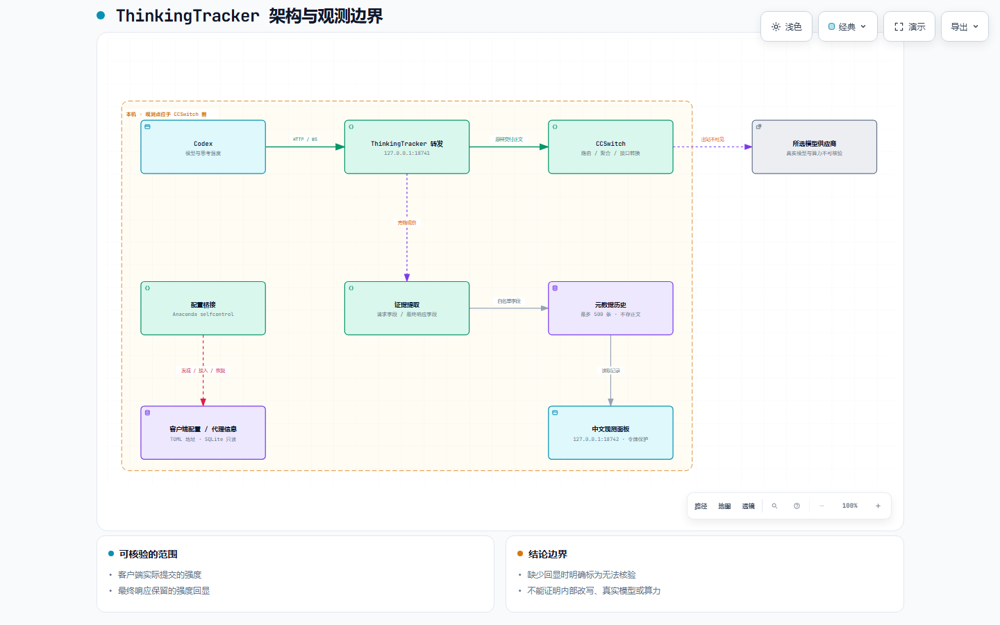
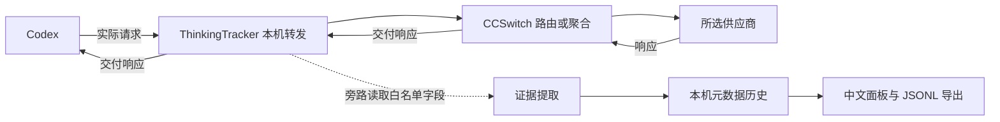

# ThinkingTracker · 思考强度探测

[](LICENSE)
[](#运行条件)
[](#运行条件)

**可双击启动的本机观测器：查看经过 CCSwitch 的 Codex 请求模型、请求思考强度，以及最终响应交付的模型与强度回显。**

支持 CCSwitch 的**路由模式和聚合模式**，不限定 AnyRouter 或其他供应商。接在统一的本地入口前，不需要逐家填写密钥。

> **结论边界：**“返回强度”指响应报文的声明。字段一致只能证明观测点上的字段一致，不能证明远端真实模型、实际思考计算量或供应商是否忠实执行。缺失回显时显示“未回显”，不根据耗时、回答质量或 token 数猜测。

[下载最新版](https://github.com/science-prince/ThinkingTracker/releases/latest) · [聚合模式](docs/聚合模式说明.md) · [使用与恢复](docs/使用与恢复.md) · [实现说明](docs/实现说明.md) · [测试报告](docs/测试报告.md)

## 功能

- 读取实际请求中的模型 ID 和 `reasoning.effort` / `reasoning_effort` 等字段。
- 分开保留首包回显与最终响应；比较请求和**最终**回显，不把首包值填进缺失的最终字段。
- 展示返回模型、思考 tokens、完成状态、用时、路由标签及关联告警。
- 区分缺失、显式 `null`、冲突、无效字段、请求失败、流中断和无法解析。
- 自动发现已接入 CCSwitch 的本机地址，提供接入、恢复、停止和异常恢复。
- 中文面板支持筛选、元数据详情和 JSONL 导出，提供不消耗模型额度的隔离演示。

工具观察你正常发送的请求，**不会自动向模型发测试题、扫描供应商或重试模型请求**。

## 快速开始：无需输入启动命令

### 下载和解压

在 [Releases](https://github.com/science-prince/ThinkingTracker/releases/latest) 下载 `ThinkingTracker-v1.0.0-windows.zip`，完整解压到可写的本地目录。也可用仓库 **Code → Download ZIP** 下载源码。不要在压缩包预览窗口里运行，也不要只复制单个 CMD 文件。

### 运行条件

| 条件 | 要求 |
| --- | --- |
| 系统 | Windows；双击入口使用自带的 Windows PowerShell 5.1 |
| Node.js | 22+，并能通过 PATH 找到 `node.exe`；已验证 24.14.0 |
| Python | Anaconda **`selfcontrol` 环境**，Python 3.11+；已验证 3.12.12 |
| CCSwitch | Codex 本地代理开启，或处于“聚合生效中”，原请求正常可用 |
| 配置 | Codex 的有效地址已经指向 CCSwitch 本机 HTTP 代理 |

项目只使用 Node 内置模块和 Python 标准库，**无需 `npm install` 或 `pip install`**。无需管理员权限，不安装抓包驱动、根证书或自启动服务。发布包没有捆绑 Node / Anaconda，尚未准备运行环境的电脑需要先安装它们。

默认 Python 路径是 `D:/Anaconda3/envs/selfcontrol/python.exe`。安装位置不同，用文本编辑器将 `设置.json` 中的 `python_path` 改成本机对应的 `envs/selfcontrol/python.exe` 绝对路径即可；环境名称仍须为 `selfcontrol`，程序会检查实际环境。

### 启用观测

1. 保持 CCSwitch 运行，确认 Codex 原先能够通过它工作。
2. 双击 **`一键启用.cmd`**，程序启动后台服务、保存恢复记录并打开面板。
3. 等当前任务结束，**彻底退出并重新打开 Codex**，使新地址生效；仅关闭聊天页可能不够。
4. 照常发送消息，面板自动记录经过它的请求。
5. 用完双击 **`停止并恢复.cmd`**，再重新打开 Codex，使原地址生效。

已有实例时一键入口会复用。**关闭网页不会停止后台服务。**平稳停止可以先点面板“恢复地址”，让 Codex 重新加载原地址，再使用停止入口。

默认面板地址是 `http://127.0.0.1:18742`。一键入口携带临时本机令牌；直接手输裸地址没有令牌时，不能读取记录或执行控制。这个令牌不是供应商 API Key。

## 双击入口

| 文件 | 用途 |
| --- | --- |
| `一键启用.cmd` | 启动、发现、接入并打开面板；已运行时复用 |
| `打开面板（不改配置）.cmd` | 只读启动；查看发现结果，不自动接入 |
| `模拟演示.cmd` | 隔离演示，不读取真实配置、不连接真实上游 |
| `停止并恢复.cmd` | 先恢复地址，等待已有请求结束后停止 |
| `紧急恢复地址.cmd` | 崩溃后按记录撤销地址修改，不强杀其他程序 |
| `运行安全自检.cmd` | 在本机模拟上游和项目内临时配置上自检 |

只读面板若发现上次遗留的恢复记录，允许你主动恢复。演示模式单独保存历史；真实面板主动加入的示例也会标记为模拟。

## 面板示例

以下是模拟数据，无真实对话或密钥；截图为早期界面，当前版本使用 ThinkingTracker 名称，操作方式相同。



## 架构和观测边界



架构图用 Archify 生成。下载后可以用浏览器打开 [独立交互式 HTML](docs/architecture/thinkingtracker.html)，切换主题、查看节点和导出；GitHub 文件页本身不执行 HTML。[规格 JSON](docs/architecture/thinkingtracker.architecture.json) 随仓库提供，查看器许可见 [第三方说明](THIRD_PARTY_NOTICES.md)。



| 模块 | 责任 |
| --- | --- |
| Node 转发层 | 转发 HTTP 正文及 WebSocket 握手 / 帧；观察失败不触发模型重试 |
| 证据层 | 白名单字段提取，识别完成状态和可比较的最终回显 |
| Python 配置桥接 | 标准库 TOML 解析、只读 SQLite、按字段接入和恢复 |
| 历史与面板 | 有界元数据保存、筛选、详情、导出及令牌保护的本机控制 |

**观测点在 CCSwitch 前。**能看到客户端提交的请求及 CCSwitch 交付的响应；看不到它转换后的真实出站报文、供应商内部路由或模型内部计算。

## 聚合模式

保持 CCSwitch 的“聚合生效中”，使用同样的一键入口，**不用切换成普通路由模式**。聚合模型仍经过统一本机入口，`ccs-供应商/模型` 会作为请求模型及路由标签记录。没有前缀的默认模型也能观察。

| 信息 | 能否核验 |
| --- | --- |
| Codex 实际发出的强度 | 请求经过本工具且报文可解析时，可以读取 |
| 最终响应保留的强度回显 | 有字段时可比较；缺失、null 单独展示 |
| CCSwitch 转换后发给供应商的强度 | 当前观测点看不到，不能从请求值推定 |
| 模型真正使用的思考算力 | 回显也不能证明 |

CCSwitch 可能按协议和供应商能力映射档位；Chat Completions / Anthropic 流式转换生成的 Responses 对象也可能没有强度回显。**“未回显”不等于未思考，“回显不同”不能直接定性为偷偷降档。**模型选择器中的可选等级是配置声明，不是执行证据；配置默认值不代替实际请求值。

同一聚合列表中切换模型通常无需重新接入；CCSwitch 重写地址后请检查接入状态。来源列显示客户端的路由标签及目录名称，不能认证实际出站来源。更多转换规则、源码依据见 [聚合模式说明](docs/聚合模式说明.md)。没有逐家真实调用验证。

## 结果含义

| 结果 | 含义 |
| --- | --- |
| 回显一致 | 请求和完整最终响应都有非 null 强度字符串，且字符串相同 |
| 回显不同 | 两个字符串不同；只证明字段差异 |
| 未回显 | 最终响应缺少强度字段，首包值不会被补作最终证据 |
| 回显 null | 最终字段存在且明确为 null；不猜测默认值 |
| 请求未指定 | 实际请求没有可比较的强度字符串 |
| 字段冲突 / 无效回显 | 多个字段冲突，或内容 / 类型不适合精确比较 |
| 未完整结束 / 请求失败 | 流未结束、连接中断、上游错误或失败响应 |
| 关联不确定 / 无法解析 | 请求重叠、消息压缩、观测超限或编码不受支持 |

例如 `high → low` 显示“回显不同”，`max → 缺失` 显示“未回显”；都不直接证明实际算力。思考 tokens 的 **0 保留为 0**，缺失显示 `—`；转换器也可能给缺失用量补零。返回模型名称可能是别名或转换结果，不是模型真实性证明。

详情中的 `known` 只表示工具认识该强度名称，不表示模型支持它。未知字符串仍可保留并精确比较；需脱敏或截断的字符串不能制造假一致。

## 协议覆盖

| 格式 | 支持情况 |
| --- | --- |
| HTTP JSON | 实际请求及完整响应的白名单字段 |
| Responses SSE | 增量事件和终止响应；首包、最终值分开 |
| Chat Completions SSE | 结束 chunk 的字段及后续用量；不从较早 chunk 制造最终回显 |
| HTTP 响应压缩 | gzip、deflate、br；有运行时解压器时支持 zstd |
| Responses WebSocket | 未压缩文本、掩码、分片、顺序多次请求 |
| 压缩 / 二进制 WebSocket | 继续透明转发，但标记不能观察；不解压 permessage-deflate |
| 重叠 WebSocket 请求 | 无法证明关联时标记不确定，不猜测配对 |

“所有来源”表示**来源不限**，请求仍必须经过被接入的同一个入口。不覆盖其他电脑、历史请求、绕开的客户端、独立 profile、命令行地址覆盖和未知私有协议。

单条 JSON / SSE 事件 / WebSocket 消息默认最多观察 4 MiB，超限停止相应观察并告警，HTTP 正文仍继续转发。HTTP 分块框架可能由 Node 重建，正文不改写，不承诺 TCP 报文逐字节相同。WebSocket 握手与帧直接转发。

## 隐私和本机数据

**不持久保存提示词、回答、思考正文、工具参数、Cookies 或认证头。**仅保存模型、强度、数字用量、时间、状态和路由提示等元数据。

转发必然让正文和认证头经过本机进程内存；配置解析也需要完整 TOML 进入内存。程序不单独读取 `auth.json`，不把认证内容另存或输出。SQLite 使用 `mode=ro`、`query_only=ON`，只选择代理信息及供应商名称，不选择供应商认证配置。

自动接入只暂时替换已经指向 CCSwitch 回环 HTTP 地址的 `openai_base_url`、`chatgpt_base_url`、`[model_providers.<id>].base_url` 端口，保留原路径。远端地址、带凭据 / 查询参数的地址不会自动改写；不修改 API Key、供应商地址或 CCSwitch 数据库。

所有监听固定为 `127.0.0.1`，控制接口检查令牌、Host 和 Origin。启动入口只允许当前 PowerShell 进程执行本目录脚本，不修改系统策略。没有遥测上传；你的正常模型请求仍按原链路发送。

| 运行文件 | 内容 |
| --- | --- |
| `data/records.json` | 默认最多 500 条真实模式的协议元数据 |
| `data/records-demo.json` | 隔离演示历史 |
| `data/recovery.json` | 地址字段、原值、新值和原配置哈希；恢复前保留 |
| `data/runtime.json` | 进程、端口、实例及临时面板令牌；不要分享 |
| `data/service.log` / `service-error.log` | 启动诊断，不输出请求正文和认证头 |
| `test-output/` | 自动化测试夹具与本机模拟数据 |

默认发现用户目录 `.codex/config.toml`（支持 `CODEX_HOME`）及 `.cc-switch/cc-switch.db`。元数据仍可能透露模型与使用时间，导出前请检查。`data/`、测试输出、本机发布审计、常见凭据及数据库已加入 `.gitignore`；不要强制添加绕过忽略规则。公开源码和发布包不含运行数据。

## 停止、恢复和更新

推荐顺序：**恢复地址 → 重启 Codex 加载原地址 → 停止转发**。面板“恢复地址”保留服务；“恢复并停止”和 CMD 停止入口先恢复，再等待已有请求结束。

恢复只修改当前值仍等于本工具接入值的字段，保留其他编辑，被你或 CCSwitch 换成别的地址时跳过。接入先保存恢复意图，写入前检查文件变化，再原子替换配置。CCSwitch 与本工具没有共享写锁，最后替换瞬间仍存在并发编辑限制；**接入和恢复时避免同时切换模式或保存配置**。工具不会不断抢写。

崩溃或强制关机后，保留 `data/recovery.json` 并双击 **`紧急恢复地址.cmd`**。运行环境损坏时，按 [使用与恢复](docs/使用与恢复.md) 只恢复记录列出的地址字段。

**还在接入时不要删除 data、移动目录或改变端口。**更新前先恢复并停止，再使用新版本接入；发布包不携带你的数据和密钥。

## 设置

停止后再编辑 `设置.json`，路径推荐使用 `/`：

```json
{
  "python_path": "D:/Anaconda3/envs/selfcontrol/python.exe",
  "dashboard_port": 18742,
  "proxy_port": 18741,
  "max_records": 500,
  "max_inspect_bytes": 4194304,
  "idle_timeout_ms": 300000
}
```

| 设置 | 作用 / 范围 |
| --- | --- |
| `python_path` | 本机 Anaconda `envs/selfcontrol/python.exe` 绝对路径，实际环境须为 selfcontrol |
| `dashboard_port` | 面板端口，1024–65535 |
| `proxy_port` | 转发端口，1024–65535；不可与面板、上游端口相同 |
| `max_records` | 历史上限，10–2000 |
| `max_inspect_bytes` | 单条观察上限，64 KiB–16 MiB |
| `idle_timeout_ms` | 空闲超时，10 秒–30 分钟，默认 5 分钟 |
| `codex_config_path`（可选） | 非默认位置的 `config.toml` 绝对路径 |
| `ccswitch_db_path`（可选） | 非默认位置的 CCSwitch 数据库绝对路径 |

配置自定义路径后，分享设置文件前移除个人用户名和目录信息。

## 排查和常见问题

| 现象 | 处理 |
| --- | --- |
| 未找到 Node | 安装 Node 22+ 并加入 PATH，再重新双击 |
| Python 桥接失败 | 检查路径、Python 3.11+ 和实际环境名 selfcontrol |
| 未发现本地代理 | 开启 Codex 代理 / 聚合，确认有效配置指向它 |
| 面板没有真实记录 | 彻底重启 Codex；检查地址覆盖、profile 和接入状态 |
| 切换后未接入 | CCSwitch 可能重写地址，确认原链路正常后再次启用 |
| 一直未回显 | 响应缺少字段或转换省略；不等于未思考 |
| 模型名称不同 | 可能有聚合前缀、别名或转换，名称不能证明模型真实性 |
| 令牌无效 | 用双击入口重新打开，不直接手输裸地址 |
| 端口被占用 | 停旧实例或停止后改端口；绑定失败不会自动接入 |
| 停止后 Codex 断连 | 紧急恢复并重启 Codex，旧进程可能缓存探测器地址 |
| 关网页后仍运行 | 网页与服务分开，用停止入口结束 |

**会消耗额度吗？**演示和自检只访问本机模拟服务器，工具不发远端测试请求。你正常发送的模型请求仍按供应商规则计费。

**能证明供应商降智吗？**不能。工具提供字段变化与缺失证据；内部行为需要独立证据。

## 测试与开发

双击 **`运行安全自检.cmd`**。全部模型报文发往随机回环端口的模拟服务器，TOML / SQLite 夹具位于项目内；Windows 启动器实际测试接入、复用、转发和恢复，操作对象均为隔离配置。

当前有 **66 项自动化检查**：证据 / 帧解析 27、转发 / 控制 / 生命周期 21、Windows 启动器 1、Python 配置事务 17。发布前对当前代码完整复测，结果和未验证范围见 [测试报告](docs/测试报告.md)。通过这些检查不代表真实供应商已逐家验证。

开发者可选用下面命令；普通使用者无需输入：

```powershell
npm test
node src/main.mjs --read-only
```

`npm test` 只运行 Node 检查，完整验证使用安全自检入口，其中包括 selfcontrol Python 测试。不要对真实上游发送测试报文。

## 目录

```text
ThinkingTracker/
├─ 一键启用.cmd / 停止并恢复.cmd / 其他双击入口
├─ 设置.json                 本机设置
├─ launch.ps1 / selftest.ps1  Windows 启动与完整检查
├─ src/                      转发、证据、历史、配置桥接
├─ public/                   中文面板，无 CDN 或前端依赖
├─ tests/                    本机模拟测试
├─ docs/                     使用、实现、聚合、测试说明
│  └─ architecture/          架构图规格、PNG 和独立 HTML
├─ LICENSE                   MIT
└─ THIRD_PARTY_NOTICES.md     文档查看器许可说明
```

## 作者、许可与参考

作者：[science-prince](https://github.com/science-prince)。项目使用 [MIT License](LICENSE)。Archify 图形查看器的版权与许可单独保留，它不是应用运行依赖。

交互目标参考 [route-scope](https://github.com/Niyu24-Hub/route-scope)，本工具的转发、配置和证据处理为独立实现，没有复制该项目源码。协议与接入规则参考：

- [CCSwitch](https://github.com/farion1231/cc-switch) 与 [聚合模式指南](https://github.com/farion1231/cc-switch/blob/main/docs/guides/aggregation-mode-guide-zh.md)
- [OpenAI Reasoning](https://developers.openai.com/api/docs/guides/reasoning)
- [Responses 流式响应](https://developers.openai.com/api/docs/guides/streaming-responses)
- [Codex 配置参考](https://developers.openai.com/codex/config-reference/)

兼容性可能随客户端、CCSwitch 和供应商变化。报告问题时请提供版本、脱敏错误和模拟复现，**不要上传密钥、完整客户端配置、真实对话、运行令牌或恢复记录**。
